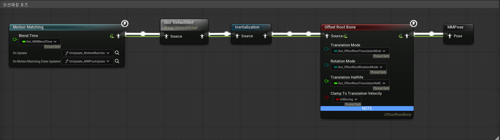
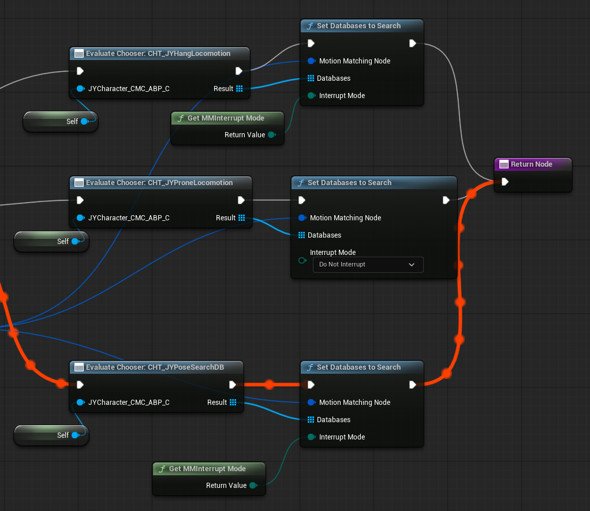
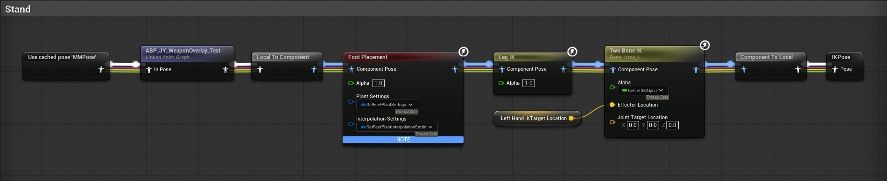
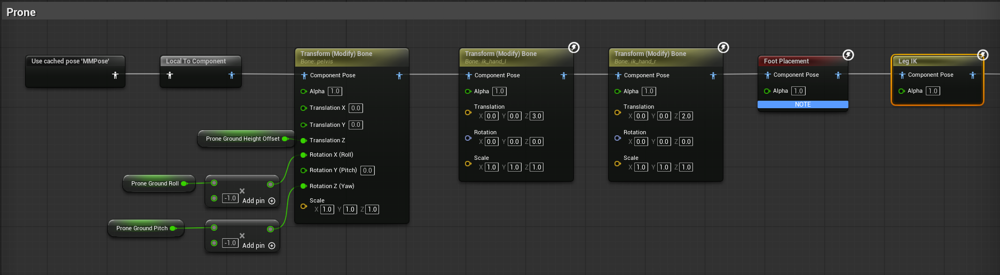
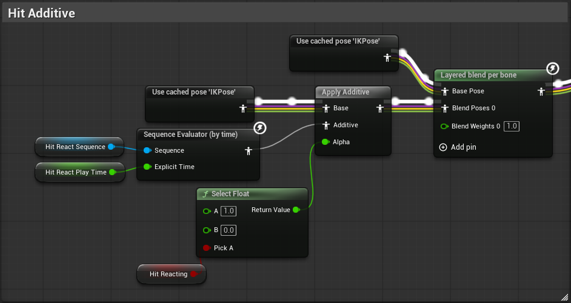
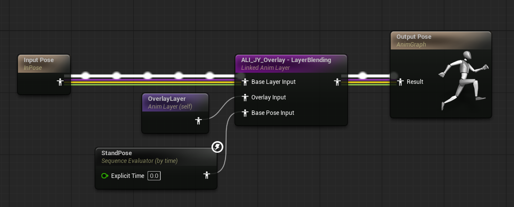
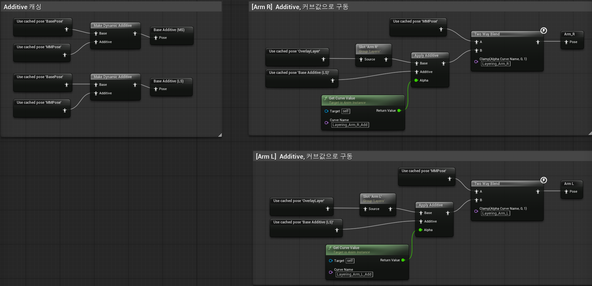
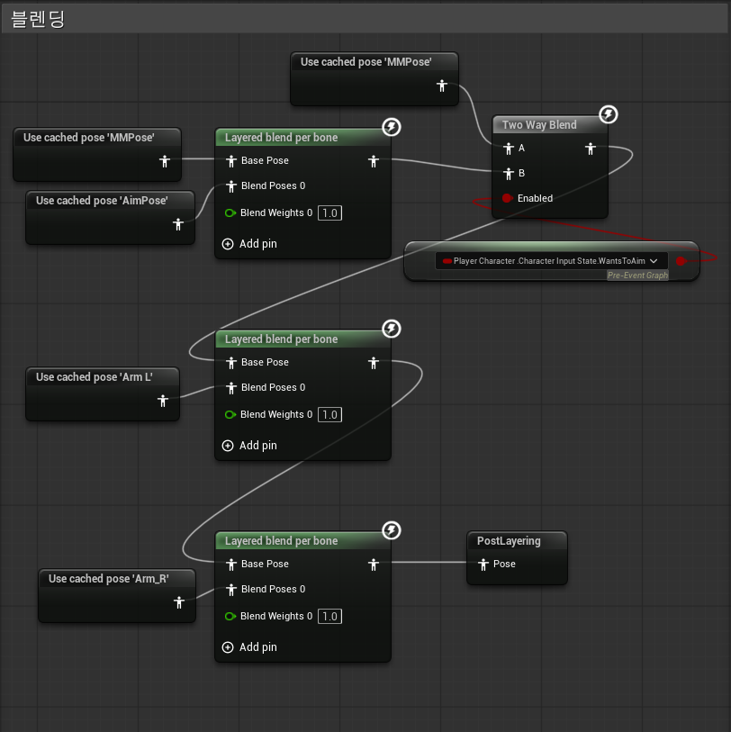

# JY_Portfolio-MM-Gun

## 프로젝트 소개

UE 5.7 기반의 멀티플레이어 슈터 프로젝트입니다.

모션 매칭을 적용하고, 캐릭터 이동 확장(매달리기, 기어가기), 총기 시스템을 구현했습니다.

 

## 개발 환경

펼치기 / 접기

 

| 구분 | 내용 |
|:---:|---|
| 엔진 | Unreal Engine 5.7 |
| 언어 | C++ |
| 사용 기술 | Gameplay Ability System · Enhanced Input · Motion Matching · Motion Warping |
| 네트워크 구조 | 서버·클라 분리 구조 (Play As Client) |
| 참고 프로젝트 | - Game Animation Sample Project - Lyra Starter Game |

 

## AI 환경

펼치기 / 접기

 

| 구분 | 내용 |
|:---:|---|
| 도구 | Claude Code |
| 공용 규칙 | - 작업의 큰 틀(방향 · 가이드라인)은 $\color{orange}{\textsf{사람이 먼저 정함}}$ - AI는 그 틀 안에서 레퍼런스(엔진 소스 · 공식 레퍼런스 프로젝트)를 확인해 설계안을 제시 - $\color{orange}{\textsf{사람이 첨삭해 확정}}$하고, $\color{orange}{\textsf{AI는 확정된 것만 구현}}$ - $\color{orange}{\textsf{추측 금지}}$ — 확인 못 한 것은 미확인으로 표시 - 커밋은 승인 후 |
| 스킬 | $\color{#2EC4B6}{\textbf{\textsf{설계 · 구현}}}$ - 구현 전 레퍼런스 확인 (엔진 소스 · 공식 레퍼런스 프로젝트) - 클래스 · 컴포넌트 · 인터페이스 등 구조 설계 기준 - Gameplay Ability System 구현 전 레퍼런스 구조 확인 - C++ 코딩 컨벤션 - 빌드 · 프로젝트 파일 생성 · 빌드 오류 추출 - 디버그 로그 · 상태 추적  $\color{#2EC4B6}{\textbf{\textsf{설명 · 문서}}}$ - 코드 · 엔진 동작 설명 형식 - 함수 호출 · 데이터 흐름 추적 - 클래스 다이어그램 (PlantUML) - 기능 흐름 HTML 페이지 - 전체 구조도 HTML 페이지 - 분석 문서 작성 - 문서 저장 위치 · 중복 방지  $\color{#2EC4B6}{\textbf{\textsf{에디터 · 에셋}}}$ - 에디터 MCP 호출 절차 - Fab 에셋 가져오기 - 프로젝트에 쓸 에셋 고르기 - 스크린샷 읽기 - 설명한 코드를 Visual Studio에 읽는 순서대로 열기 (헤더 · cpp 좌우 배치)  $\color{#2EC4B6}{\textbf{\textsf{작업 관리}}}$ - 진행 문서 기록 · 이어가기 - 두 세션 동시 작업 규칙 |
| 훅 | - 세션 시작 — 진행 문서의 다음 할 일을 자동으로 불러옴 - 빌드 명령 직전 — 에디터가 켜져 있는지 확인해 알림 - 파일 수정 후 — 고친 C++ 소스를 기록 - 응답 종료 전 — C++ 소스를 고치고 빌드하지 않았으면 끝내지 못하게 알림 - 입력 대기 — 윈도우 알림 |
| 에디터 연동 | - 언리얼 에디터 MCP - 에디터 전용 C++ 툴셋 (StateTree · AnimGraph · Level 등) |
| 진행 관리 | - 기능별 진행 문서에 기록 - 결정과 이유 · 지금까지 한 일 · 다음 할 일 · 막힌 문제 |

 

## 데모 영상

펼치기 / 접기

 

https://youtu.be/kAqVKhKEXf0

 

## 주요 기능

펼치기 / 접기

 

### 1. Motion Matching & Parkour

- GASP 구조를 참고한 Motion Matching 기반 이동 시스템 적용
- 파쿠르 액션 구조 분석 및 프로젝트에 맞게 연동

### 2. Ledge Hang & Movement

- 난간 감지 및 매달리기 처리
- 난간 상태에서의 좌우 이동 구현

### 3. Prone System

- 기어가기 상태 구현 (경사면 포함)
- 양손 / 양발 IK

### 4. Weapon System

- 총기 IK 구성
- Gameplay Ability System(GAS) 기반 무기 발사 구현
- Hitscan / 탄도학 기반 사격 구현
- 재질별 관통 판정
- 벽 근접 시 총기 올림
- 무기 슬롯별 Attach / Detach
- 총기 확산 (Spread)
- Tracer / Muzzle Flash / Shell Eject / Material-based Impact / Camera Shake 사격 연출
- Data Asset 기반 무기 데이터 관리

 

## 클래스 구조도

펼치기 / 접기

 

[클래스 구조도 보기](https://hanjongyun.github.io/JY_Portfolio-MM-Gun/)

 

## 애니메이션 그래프 참고자료 (스크린샷)

펼치기 / 접기

 

### Main Anim Graph

#### Motion Matching

#### Chooser Table 

#### Stand

#### Prone

#### Hit

 

### Overlay Graph

#### Overlay_MainAnimGraph

#### Overlay Additive

#### Overlay Blending

